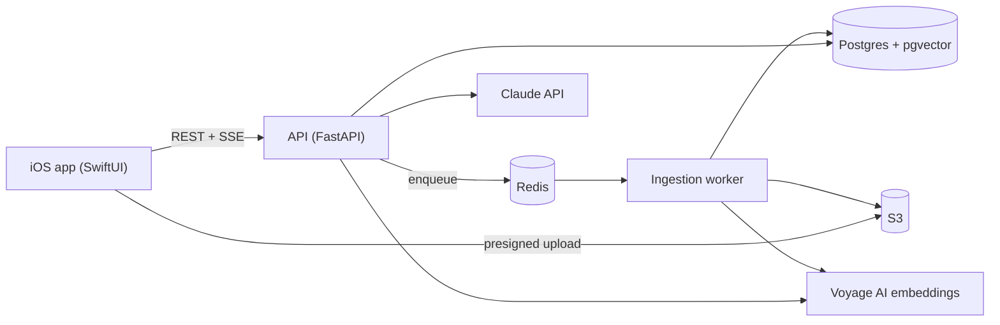

# Recall

A personal knowledge assistant for iPhone. Add PDFs, web links, camera scans and notes, then ask questions and get streamed answers with citations back to the exact source passage.

Built to show end-to-end skills: native iOS (SwiftUI), retrieval-augmented generation with Claude, an OpenAPI-documented REST backend, and infrastructure as code on AWS.

## Architecture



Full design (requirements, HLD, LLD, decisions): [docs/architecture.md](docs/architecture.md)
API contract: [api/openapi.yaml](api/openapi.yaml)

## Tech

| Layer | Stack |
|-------|-------|
| iOS | Swift 6, SwiftUI, SwiftData, VisionKit, swift-openapi-generator |
| Backend | Python 3.12, FastAPI, SQLAlchemy 2, arq |
| Data | PostgreSQL 16 + pgvector, Redis, S3 |
| AI | Claude (answers, query rewrite), Voyage AI (embeddings, rerank) |
| Infra | Docker Compose, Terraform on AWS (ECS Fargate, RDS, ElastiCache, S3), GitHub Actions |

## Repository layout

```text
api/        OpenAPI 3.1 spec (source of truth for the API)
backend/    FastAPI service and ingestion worker
ios/        SwiftUI app and share extension
infra/      Terraform and docker-compose
docs/       Architecture and design decisions
```

## Roadmap

- [x] Phase 0: design (architecture doc, OpenAPI spec, repo layout)
- [ ] Phase 1: backend skeleton, auth, CRUD, docker-compose, CI
- [ ] Phase 2: RAG core (ingestion, hybrid retrieval, streaming answers, eval set)
- [ ] Phase 3: iOS app (generated client, library, chat with citations)
- [ ] Phase 4: native polish (scan + OCR, share extension, offline, flashcards)
- [ ] Phase 5: AWS deploy with Terraform, observability, TestFlight
- [ ] Phase 6: demo GIF, metrics, write-up

## Viewing the API docs

Until the backend exists, paste `api/openapi.yaml` into https://editor.swagger.io to browse it. From Phase 1 the running API serves Swagger UI at `http://localhost:8000/docs`.
