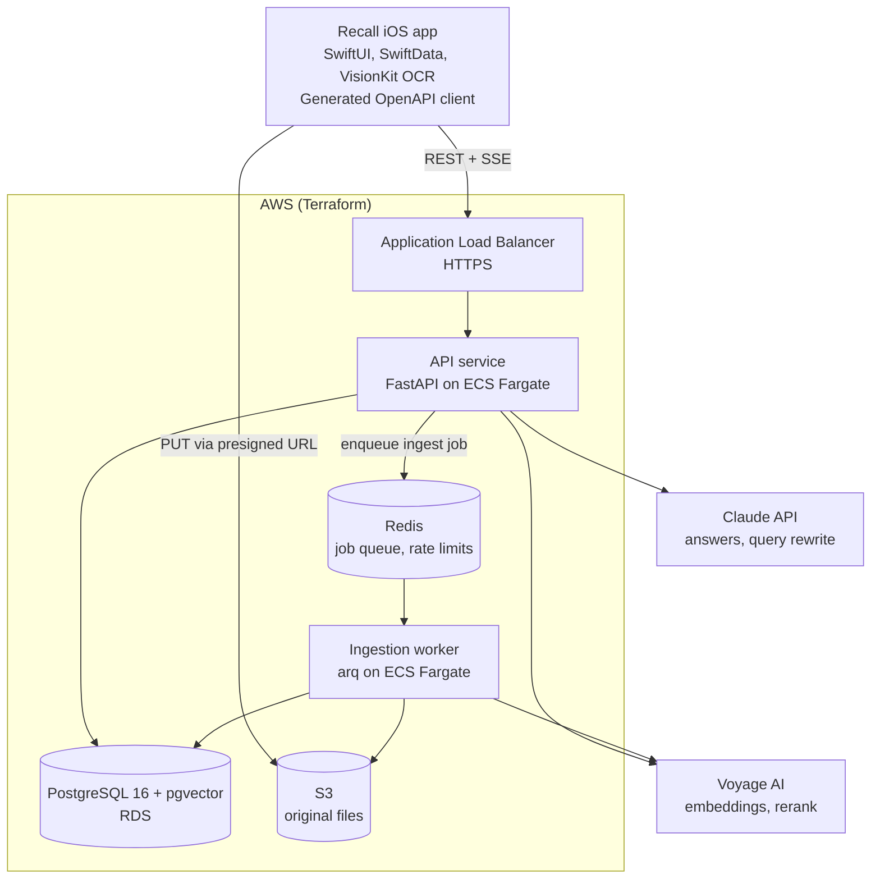
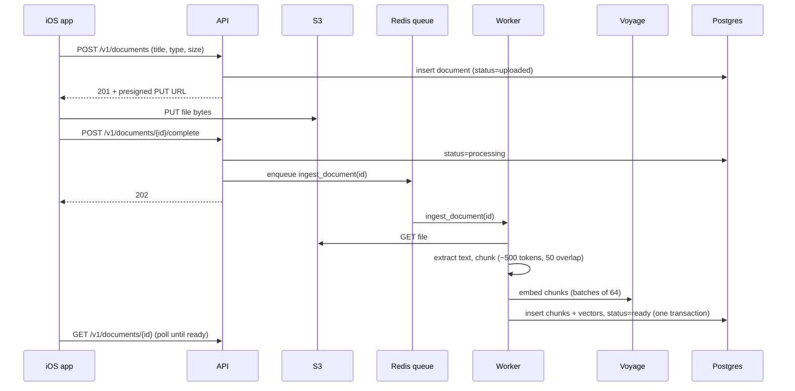
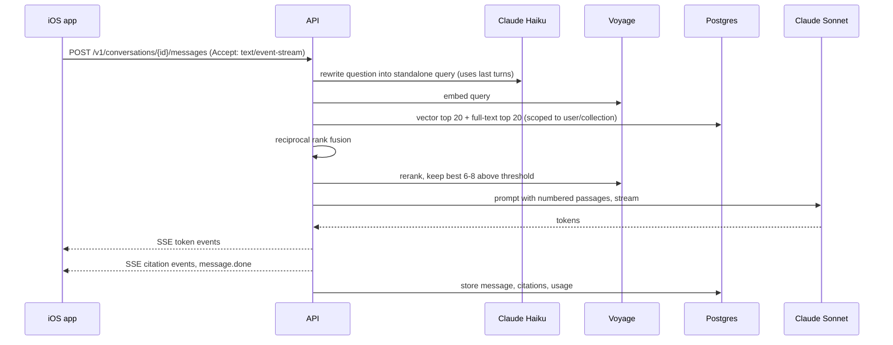
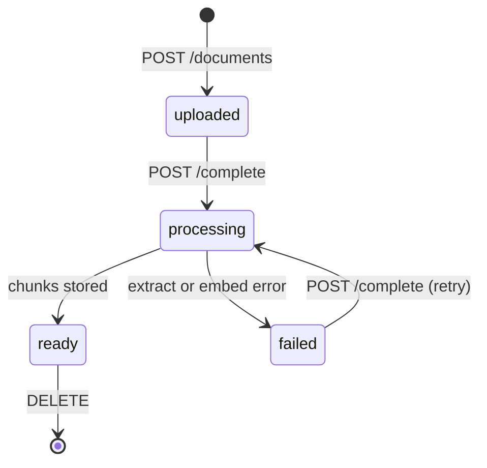

# Recall architecture

Recall is a personal knowledge assistant for iPhone. Users add PDFs, web links, camera scans and notes, then ask questions and get streamed answers with citations back to the exact source passage.

This document is the single source of truth for the design. The API contract lives in [`api/openapi.yaml`](../api/openapi.yaml).

## 1. Requirements

### Functional

| # | Requirement |
|---|-------------|
| F1 | Sign in with Apple |
| F2 | Add sources: PDF import, web URL, camera scan (on-device OCR), plain note, Safari share sheet |
| F3 | See ingestion status for each source (uploaded, processing, ready, failed) |
| F4 | Group sources into collections |
| F5 | Ask questions across all sources or one collection; the answer streams in with numbered citations |
| F6 | Tap a citation to open the source passage and page |
| F7 | Browse past conversations, offline |
| F8 | Generate flashcards from a document |

### Non-functional targets

| Metric | Target |
|--------|--------|
| Time to first answer token | p95 under 2 s |
| Ingest a 50-page PDF | under 60 s |
| Cost per answered question | under US$0.01 |
| Max upload size | 50 MB |
| Tenant isolation | No query can return another user's data |
| Availability | Single region, stateless services, 99.5% |

### Out of scope for v1

Sharing between users, Android or web clients, real-time collaborative editing, on-device LLM.

## 2. High-level design



### Components

| Component | Responsibility | Scales by |
|-----------|----------------|-----------|
| iOS app | Capture, upload, chat UI, offline cache | n/a |
| API service | Auth, CRUD, retrieval, prompting, SSE streaming | CPU, request count |
| Ingestion worker | Extract text, chunk, embed, store | Queue depth |
| PostgreSQL + pgvector | Users, documents, chunks + vectors, conversations | Vertical first, then read replicas |
| Redis | Job queue, rate-limit buckets, short-lived caches | Vertical |
| S3 | Original uploaded files | Managed |
| Claude | Answer generation (Sonnet), query rewrite and titles (Haiku) | Managed, rate limits |
| Voyage AI | Embeddings (1024-dim), reranking | Managed, rate limits |

### Key flows

**Upload and ingest**



**Ask a question**



### Design decisions

| Decision | Chosen | Rejected | Why |
|----------|--------|----------|-----|
| Vector store | pgvector in Postgres | Pinecone, Qdrant | One system to run; documents and chunks change in one transaction; HNSW is fast enough to millions of chunks. The `Retriever` interface keeps a later move cheap. |
| Ingestion | Async worker via Redis queue | Inline in the request | A large PDF takes tens of seconds; requests must stay fast. |
| Streaming | Server-Sent Events | WebSockets | Answers flow one way; SSE passes through load balancers untouched and maps to Swift `AsyncThrowingStream`. |
| Uploads | Presigned S3 PUT | Multipart through the API | API never holds large bodies in memory; less bandwidth on the API tier. |
| Retrieval | Hybrid (vector + full-text) with RRF and rerank | Pure vector | Exact terms (names, acronyms, error codes) are missed by embeddings alone. Measure the gain on the eval set. |
| API style | OpenAPI-first REST, client generated | GraphQL | Simple resource model; the generated Swift client keeps app and API in lockstep. |
| Auth | Sign in with Apple, then own JWTs | Apple token on every call | Short-lived access tokens (15 min), rotating refresh tokens, no dependence on Apple at request time. |
| LLM tiers | Sonnet for answers, Haiku for rewrite and titles | One model for all | Cheap model for cheap tasks keeps cost per answer down. |

### Security

- Every repository query filters by `user_id`; `chunks` carries `user_id` so the retrieval path never joins to check ownership.
- Access tokens expire in 15 minutes; refresh tokens are single use and reuse revokes the family.
- Presigned URLs expire in 10 minutes and are bound to content type and size.
- Secrets (Anthropic, Voyage, JWT signing key, DB password) live in AWS Secrets Manager.
- Uploaded text is untrusted: it goes into the prompt inside clearly delimited source blocks, and the system prompt tells the model to treat source text as data, never as instructions (prompt-injection defence).
- Rate limits per user: 30 questions a minute, 60 uploads an hour.

### Scaling path

| Load | Change |
|------|--------|
| 10x users | More API and worker tasks; Postgres read replica for list endpoints; cache query embeddings in Redis |
| 100x chunks | Partition `chunks` by `user_id` hash; tune HNSW `ef_search`; consider a dedicated vector store behind `Retriever` |
| Cost pressure | Prompt caching for the system prompt; fewer, better chunks after rerank; Haiku for simple questions |

## 3. Low-level design

### Data model

```sql
create extension if not exists vector;

create table users (
  id          uuid primary key default gen_random_uuid(),
  apple_sub   text not null unique,
  email       text,
  display_name text,
  created_at  timestamptz not null default now()
);

create table collections (
  id         uuid primary key default gen_random_uuid(),
  user_id    uuid not null references users(id) on delete cascade,
  name       text not null,
  created_at timestamptz not null default now()
);

create table documents (
  id            uuid primary key default gen_random_uuid(),
  user_id       uuid not null references users(id) on delete cascade,
  collection_id uuid references collections(id) on delete set null,
  title         text not null,
  source_type   text not null check (source_type in ('pdf','url','scan','note')),
  source_url    text,
  s3_key        text,
  status        text not null default 'uploaded'
                check (status in ('uploaded','processing','ready','failed')),
  page_count    int,
  error         text,
  created_at    timestamptz not null default now(),
  updated_at    timestamptz not null default now()
);
create index on documents (user_id, created_at desc);

create table chunks (
  id          uuid primary key default gen_random_uuid(),
  document_id uuid not null references documents(id) on delete cascade,
  user_id     uuid not null references users(id) on delete cascade,
  ordinal     int not null,
  page        int,
  content     text not null,
  token_count int not null,
  embedding   vector(1024) not null,
  tsv         tsvector generated always as (to_tsvector('english', content)) stored
);
create index on chunks using hnsw (embedding vector_cosine_ops);
create index on chunks using gin (tsv);
create index on chunks (user_id, document_id);

create table conversations (
  id            uuid primary key default gen_random_uuid(),
  user_id       uuid not null references users(id) on delete cascade,
  collection_id uuid references collections(id) on delete set null,
  title         text not null default 'New conversation',
  created_at    timestamptz not null default now()
);

create table messages (
  id              uuid primary key default gen_random_uuid(),
  conversation_id uuid not null references conversations(id) on delete cascade,
  role            text not null check (role in ('user','assistant')),
  content         text not null,
  citations       jsonb not null default '[]',
  input_tokens    int,
  output_tokens   int,
  latency_ms      int,
  created_at      timestamptz not null default now()
);
create index on messages (conversation_id, created_at);

create table refresh_tokens (
  id         uuid primary key default gen_random_uuid(),
  user_id    uuid not null references users(id) on delete cascade,
  family_id  uuid not null,
  token_hash text not null unique,
  used_at    timestamptz,
  expires_at timestamptz not null
);
```

### Document state machine



### API

See [`api/openapi.yaml`](../api/openapi.yaml). Summary:

| Method | Path | Purpose |
|--------|------|---------|
| POST | /v1/auth/apple | Apple identity token to access + refresh JWT |
| POST | /v1/auth/refresh | Rotate tokens |
| GET | /v1/me | Current user |
| GET, POST | /v1/collections | List, create |
| PATCH, DELETE | /v1/collections/{id} | Rename, delete |
| GET, POST | /v1/documents | List with status; create + presigned upload |
| POST | /v1/documents/url | Ingest a web page |
| GET, PATCH, DELETE | /v1/documents/{id} | Detail, rename/move, delete |
| POST | /v1/documents/{id}/complete | Queue ingestion |
| GET | /v1/documents/{id}/chunks/{chunkId} | Source passage for a citation |
| POST | /v1/documents/{id}/flashcards | Generate flashcards |
| GET, POST | /v1/conversations | List, start |
| DELETE | /v1/conversations/{id} | Delete |
| GET, POST | /v1/conversations/{id}/messages | History; ask (SSE stream) |
| GET | /healthz, /readyz | Probes |

Conventions: RFC 9457 problem+json errors, cursor pagination, `Idempotency-Key` on creates, per-user rate limits with `Retry-After`.

### RAG pipeline

Ingestion (worker):

1. Fetch the file from S3, or the page for a URL.
2. Extract text: `pypdf` for PDF (keeps page numbers), `trafilatura` for HTML; scans arrive as OCR text from the device.
3. Chunk: ~500 tokens with 50-token overlap, splitting on headings, then paragraphs, then sentences. Each chunk keeps its page.
4. Embed in batches of 64 with Voyage (`input_type="document"`), exponential backoff on 429/5xx.
5. In one transaction: delete old chunks for the document, insert new ones, set `status=ready`.
6. On any error: `status=failed`, `error` set, job not retried automatically more than 3 times.

Query (API):

1. Rewrite the latest question into a standalone query using the last 4 turns (Haiku). Skip on the first turn.
2. Embed the query (`input_type="query"`).
3. Retrieve top 20 by cosine similarity and top 20 by `ts_rank`, both filtered by `user_id` (and `collection_id` / `document_ids` if set).
4. Fuse with reciprocal rank fusion (k = 60).
5. Rerank the fused list with Voyage; keep the best 6 to 8 above a relevance threshold.
6. If nothing survives, answer "I couldn't find that in your sources" without calling Sonnet.
7. Prompt Sonnet with numbered `<source id="n">` blocks and instructions to cite as `[n]` and use only the sources.
8. Stream tokens as SSE; after the stream, parse `[n]` markers and emit `citation` events for the ones used.
9. Persist the assistant message with citations, token usage and latency.

### Backend layout (Python 3.12, FastAPI)

```text
backend/
  app/
    main.py              # app factory, routers, middleware
    api/v1/              # auth.py, collections.py, documents.py, conversations.py (thin routers)
    schemas/             # Pydantic models; generate the served OpenAPI, checked against api/openapi.yaml in CI
    services/            # AuthService, DocumentService, IngestionService, ChatService
    rag/
      chunker.py         # Chunker
      embedder.py        # Embedder protocol + VoyageEmbedder
      retriever.py       # HybridRetriever (vector + FTS + RRF)
      reranker.py        # Reranker protocol + VoyageReranker
      prompt.py          # PromptBuilder
    llm/
      client.py          # LLMClient protocol + ClaudeClient (stream, retries, usage)
    repositories/        # SQLAlchemy 2 async; the only place SQL lives
    workers/             # arq settings + tasks: ingest_document, generate_flashcards
    core/                # config, security (JWT), rate_limit, logging, telemetry, errors
  migrations/            # Alembic
  tests/                 # unit (fakes for Embedder/LLMClient) + integration (real Postgres)
```

Key interfaces:

```python
class Embedder(Protocol):
    async def embed_documents(self, texts: list[str]) -> list[list[float]]: ...
    async def embed_query(self, text: str) -> list[float]: ...

class LLMClient(Protocol):
    def stream(self, system: str, messages: list[dict], max_tokens: int) -> AsyncIterator[LLMEvent]: ...

class Retriever(Protocol):
    async def retrieve(self, user_id: UUID, query: str, scope: Scope, k: int) -> list[ScoredChunk]: ...
```

Patterns to talk about: dependency injection via FastAPI `Depends`, Strategy for `Embedder` / `LLMClient` / `Retriever`, Repository for data access, explicit state machine for ingestion.

### iOS layout (Swift 6, SwiftUI, iOS 18+)

```text
ios/
  Recall.xcodeproj
  Recall/
    App/                 # RecallApp, AppRouter (NavigationStack), DependencyContainer
    Features/
      Library/           # LibraryView, LibraryViewModel (@Observable)
      DocumentDetail/
      Chat/              # ChatView, ChatViewModel, CitationChip
      Collections/
      Capture/           # scan, import, paste link
      Settings/
  Packages/
    Networking/          # swift-openapi-generator client from api/openapi.yaml,
                         # AuthMiddleware (JWT, refresh on 401), SSEClient -> AsyncThrowingStream<ChatEvent>
    Persistence/         # SwiftData models, LibraryStore actor
    Capture/             # DocumentScanner (VisionKit), OCRService (Vision), PDFImporter
  ShareExtension/        # accepts URLs and PDFs, hands off through the app group
  RecallTests/           # view-model tests with protocol mocks
```

Pattern: MVVM with `@Observable` view models; services are protocols injected through the SwiftUI environment; all I/O is async/await; actors guard shared mutable state.

## 4. Observability and quality

- OpenTelemetry traces across API, worker and outbound LLM/embedding calls.
- Structured JSON logs with `request_id` and `user_id` (hashed).
- Metrics: time to first token, total latency, tokens in/out, cost per answer, ingestion duration, queue depth.
- RAG eval set: 30+ questions over sample documents with expected source passages. Scored in CI for retrieval hit rate@k and citation accuracy.
